<div align="center">
  
</div>

<br />

<div align="center">
  <a href="https://github.com/AlyssonCx4?tab=followers">
    
  </a>
  
  
</div>

## `~/sobre`

Desenvolvedor web em **Caxias–MA**, com foco em **sistemas** e **automação**. Gosto de
pegar um processo manual, quebrar em partes e devolver ele rodando sozinho — com uma
interface decente por cima.

Trabalho de ponta a ponta: **front-end** em React/Next.js com TypeScript, **back-end**
em Node.js, C#/.NET e Python, **autenticação** com NextAuth v5 e **automações** orquestradas
com n8n e agentes de IA.

```bash
$ whoami
dev web · sistemas · automação
$ uptime
online, construindo e quebrando coisas em ambiente controlado
```

## `~/o-que-eu-faço`

| Área               | Entrega                                                                                                 |
| :----------------- | :------------------------------------------------------------------------------------------------------ |
| **Web apps**       | Interfaces em React e Next.js com TypeScript, Tailwind CSS e estado previsível com Zustand.             |
| **Sistemas**       | APIs, integrações e serviços em Node.js, C#/.NET e Python — além de automação industrial com Ladder.    |
| **IA & Automação** | Agentes e chatbots com Claude, fluxos no n8n, prompt engineering e dados de série temporal no InfluxDB. |

## `~/stack`

### Front-end


### Back-end


### IA & Automação


### Banco de dados


## `~/stats`

<div align="center">
  
  
</div>

<br />

<div align="center">
  <picture>
    <source media="(prefers-color-scheme: dark)" srcset="https://raw.githubusercontent.com/AlyssonCx4/AlyssonCx4/main/output/pacman-contribution-graph-dark.svg">
    <source media="(prefers-color-scheme: light)" srcset="https://raw.githubusercontent.com/AlyssonCx4/AlyssonCx4/main/output/pacman-contribution-graph.svg">
    
  </picture>
</div>

<br />

<div align="center">
  
</div>

## `~/projetos`

Ainda estou organizando os repositórios públicos. Em breve, os projetos que melhor
representam o que eu construo ficam **fixados aqui no perfil**.

<!--
Modelo para quando quiser listar projetos aqui:

| Projeto | O que é | Stack |
| :--- | :--- | :--- |
| [nome-do-projeto](https://github.com/AlyssonCx4/nome-do-projeto) | Uma frase explicando o problema resolvido. | Next.js · Node.js · PostgreSQL |
| [outro-projeto](https://github.com/AlyssonCx4/outro-projeto) | Outra frase curta e direta. | Python · n8n · Claude |
-->

## `~/contato`

<div align="center">
  <a href="mailto:allisoncx4@gmail.com">
    
  </a>
  <a href="https://github.com/AlyssonCx4">
    
  </a>
  <a href="https://www.linkedin.com/in/alysson-morais-20038436b/">
    
  </a>
</div>

<br />

<div align="center">
  <sub>feito com terminal, café e um pouco de automação.</sub>
</div>

<!--
  Perfil: AlyssonCx4 · Alysson Morais · Caxias–MA
  E-mail: allisoncx4@gmail.com · LinkedIn: /in/alysson-morais-20038436b
  Passo a passo completo em COMO-USAR.md
-->
